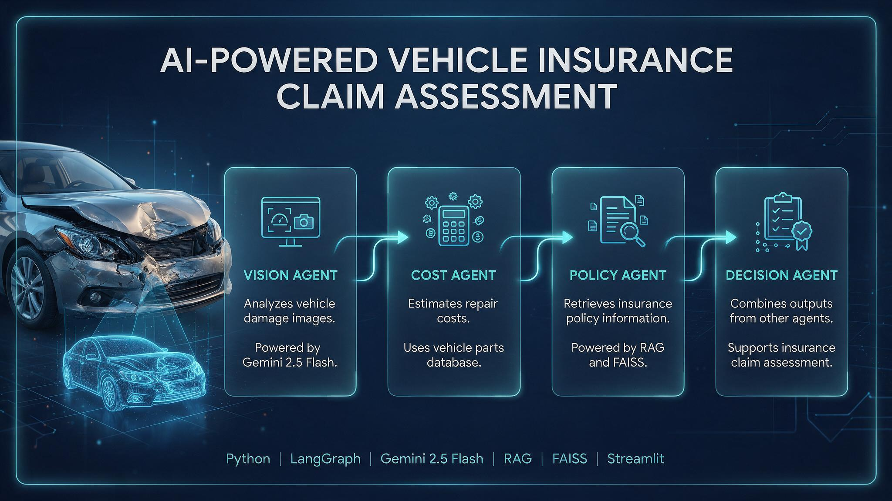

# 🚗 AI-Powered Vehicle Insurance Claim Assessment System

An intelligent multi-agent AI application that analyzes vehicle damage images, estimates repair costs, retrieves insurance policy information, and generates a claim assessment recommendation.



## 📌 Project Overview

Vehicle insurance claim assessment involves multiple steps, including damage inspection, repair cost estimation, and policy verification.

This project explores how **Generative AI and Multi-Agent Systems** can streamline this process through an automated AI-powered workflow.

Built using **LangGraph, Gemini 2.5 Flash, RAG, FAISS, and Streamlit**, the application processes uploaded vehicle damage images and generates structured claim assessment results.

## ✨ Key Features

- 📷 **Vehicle Damage Detection:** Analyzes uploaded vehicle images and identifies visible damage.
- 🔍 **Damage Severity Analysis:** Generates damage summaries and identifies affected vehicle parts.
- 💰 **Repair Cost Estimation:** Estimates replacement parts, labour costs, and total repair expenses using parts data.
- 📄 **Insurance Policy Analysis:** Retrieves relevant policy information using Retrieval-Augmented Generation (RAG).
- 🤖 **Multi-Agent Collaboration:** Uses specialized AI agents to handle different stages of claim assessment.
- ✅ **Claim Recommendation:** Combines analysis results to generate a structured claim assessment recommendation.

## 🏗️ Multi-Agent Architecture

The system uses LangGraph to coordinate specialized agents.

### 1. Vision Agent
- Analyzes vehicle damage images.
- Identifies damaged vehicle components.
- Assesses damage severity.
- Uses Gemini 2.5 Flash for image understanding.

### 2. Cost Agent
- Identifies replacement parts.
- Retrieves pricing information from `parts.csv`.
- Estimates parts and labour costs.
- Calculates the total estimated repair cost.

### 3. Policy Agent
- Retrieves relevant insurance policy information.
- Uses Jina Embeddings for document embeddings.
- Uses FAISS for vector similarity search.
- Uses RAG to provide context-aware policy analysis from `policy.pdf`.

### 4. Decision Agent
- Combines outputs from the other agents.
- Evaluates damage analysis, repair estimates, and policy information.
- Generates a structured claim recommendation.

## 🔄 Application Workflow

1. Upload a vehicle damage image.
2. Submit the image for analysis through the Streamlit interface.
3. The LangGraph workflow processes the request.
4. The Vision Agent analyzes vehicle damage.
5. The Cost Agent estimates repair expenses.
6. The Policy Agent retrieves relevant insurance information.
7. The Decision Agent combines the available results.
8. The application displays the claim assessment output.

## 🛠️ Technology Stack

| Category | Technologies |
|---|---|
| Programming Language | Python |
| LLM | Gemini 2.5 Flash |
| Agent Orchestration | LangGraph |
| Computer Vision | Gemini Vision |
| Embeddings | Jina Embeddings |
| Vector Database | FAISS |
| RAG | Retrieval-Augmented Generation |
| Frontend | Streamlit |
| Data Processing | Pandas |

## 📂 Project Structure

```text
Insurance_claim_agent/
│
├── agents/
│   ├── vision_agent.py
│   ├── cost_agent.py
│   ├── policy_agent.py
│   └── decision_agent.py
│
├── graph/
│   └── graph.py
│
├── docs/
│   └── generated-image.jpg
│
├── notebooks/
├── temp/
│
├── app.py
├── requirements.txt
└── README.md
```

*Note: Update the agent filenames above if your actual filenames differ.*

## ⚙️ Installation and Setup

### 1. Clone the Repository

```bash
git clone https://github.com/mohanraj-Ai/Insurance_claim_agent.git

cd Insurance_claim_agent
```

### 2. Create a Virtual Environment

```bash
python -m venv .venv
```

Activate on Windows:

```bash
.venv\Scripts\activate
```

### 3. Install Dependencies

```bash
pip install -r requirements.txt
```

### 4. Configure API Credentials

Configure your Gemini API key and any other required credentials using environment variables or your local secrets configuration.

Never upload API keys or credentials to GitHub.

### 5. Run the Application

```bash
streamlit run app.py
```

## 🎯 Project Objectives

- Explore practical applications of Agentic AI in the automotive industry.
- Automate different stages of vehicle insurance claim assessment.
- Combine computer vision, LLMs, and RAG in a single application.
- Demonstrate collaborative AI agent workflows using LangGraph.
- Apply Generative AI to real-world automotive insurance challenges.

## ⚠️ Disclaimer

This project is an experimental AI-based claim assessment prototype. Its outputs are recommendations for evaluation and should not be treated as official insurance approval or a substitute for professional vehicle inspection.

## 🚀 Future Enhancements

- Support multiple vehicle damage images.
- Improve repair cost estimation with real-world pricing data.
- Add structured insurance claim document processing.
- Introduce human review and approval workflows.
- Improve evaluation of damage analysis and claim recommendations.

## 👨‍💻 Author

**Mohanraj P**

Generative AI | AI/ML | Automotive AI

- GitHub: https://github.com/mohanraj-Ai
- LinkedIn: https://linkedin.com/in/mohanraj-p-2bb994217

---

⭐ If you find this project interesting, feel free to explore the repository and share your feedback.

