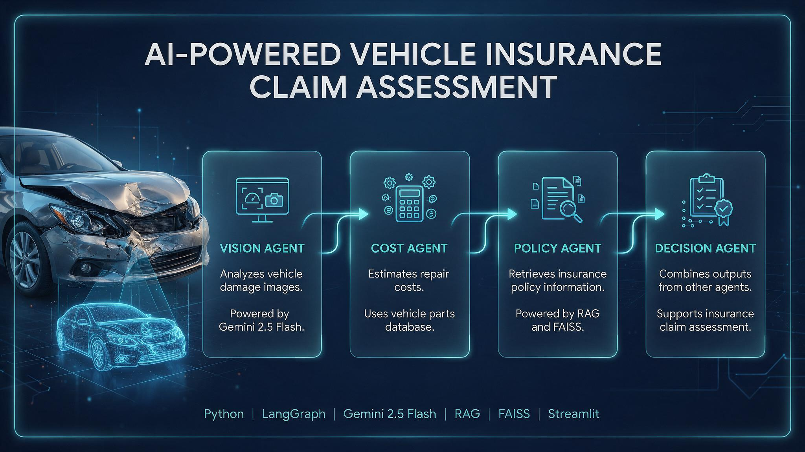

# 🚗 Insurance Claim AI Agent



## 📌 Project Overview

The **Insurance Claim AI Agent** is an AI-powered vehicle insurance claim assessment system built using **Python, LangGraph, Gemini 2.5 Flash, and Streamlit**.

The system uses multiple AI agents to analyze vehicle damage, estimate repair costs, retrieve insurance policy information, and generate a claim assessment recommendation.

## ✨ Key Features

- Upload vehicle damage images for AI analysis.
- Identify damaged vehicle parts and assess damage severity.
- Estimate repair costs using parts data.
- Retrieve relevant insurance policy information.
- Generate a final claim assessment recommendation.
- Interactive Streamlit web interface.

## 🤖 Multi-Agent Architecture

### 1. Vision Agent
- Uses Gemini 2.5 Flash.
- Analyzes uploaded vehicle damage images.
- Identifies damaged parts and damage severity.

### 2. Cost Agent
- Uses vehicle spare-parts data from `parts.csv`.
- Identifies replacement parts.
- Estimates parts cost, labour cost, and total repair cost.

### 3. Policy Agent
- Uses RAG (Retrieval-Augmented Generation).
- Generates embeddings using Jina Embeddings.
- Uses FAISS for similarity search.
- Retrieves relevant information from insurance policy documents.

### 4. Decision Agent
- Combines the outputs from the other agents.
- Generates a claim assessment recommendation.
- Provides the estimated approved amount and decision reason.

## 🔄 Workflow

1. User uploads a vehicle damage image through Streamlit.
2. Vision Agent analyzes the damage.
3. Cost Agent estimates the repair expenses.
4. Policy Agent retrieves relevant insurance policy information.
5. Decision Agent combines the results.
6. The application displays the final claim assessment.

## 🛠️ Technology Stack

- **Programming Language:** Python
- **Agent Framework:** LangGraph
- **LLM:** Gemini 2.5 Flash
- **RAG:** Jina Embeddings, FAISS
- **Frontend:** Streamlit
- **Data Processing:** Pandas

## 📂 Project Structure

```text
Insurance_claim_agent/
│
├── agents/
├── graph/
├── notebooks/
├── docs/
│   └── generated-image.jpg
├── temp/
│
├── app.py
├── requirements.txt
└── README.md
```

## ⚙️ Installation & Setup

### 1. Clone the Repository

```bash
git clone https://github.com/mohanraj-Ai/Insurance_claim_agent.git
cd Insurance_claim_agent
```

### 2. Create a Virtual Environment

```bash
python -m venv venv
```

### 3. Activate the Environment

**Windows:**
```bash
venv\Scripts\activate
```

### 4. Install Dependencies

```bash
pip install -r requirements.txt
```

### 5. Configure API Keys

Set the required API keys in your environment or `.env` file according to your project configuration.

### 6. Run the Application

```bash
streamlit run app.py
```

## 🎯 Project Objectives

- Explore multi-agent AI systems using LangGraph.
- Apply computer vision capabilities to automotive insurance.
- Integrate RAG for insurance policy information retrieval.
- Automate repair cost estimation.
- Demonstrate how AI agents can collaborate in real-world automotive applications.

## ⚠️ Disclaimer

This project is a prototype developed for learning and demonstration purposes. The generated claim assessments are AI-based recommendations and should not be considered official insurance approvals.

## 🚀 Future Enhancements

- Support additional vehicle types and damage categories.
- Improve repair cost estimation accuracy.
- Add human review and approval workflows.
- Integrate with real insurance claim management systems.

## 👨‍💻 Author

**Mohanraj P**

- LinkedIn: https://linkedin.com/in/mohanraj-p-2bb994217
- GitHub: https://github.com/mohanraj-Ai
