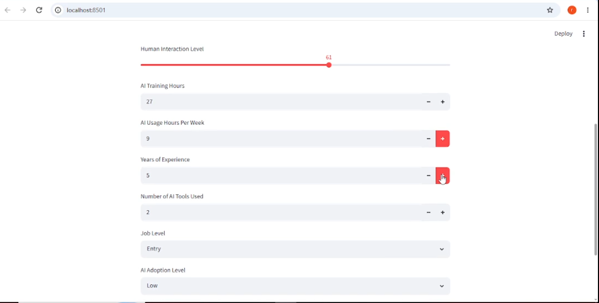
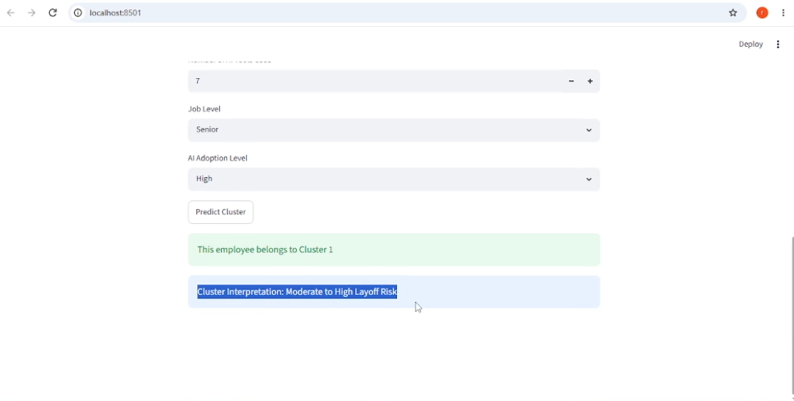

# AI Workforce Clustering

An employee segmentation project exploring patterns in automation exposure,
routine work, creativity, human interaction, and AI adoption.

The project combines feature analysis, clustering experiments, and an
interactive Streamlit application that assigns employee profiles to
trained workforce clusters.

## Application Preview



## Project Overview

This project analyzes a dataset containing 20,000 records and 16 original
columns to explore workforce segments associated with different
layoff-risk label distributions.

The application accepts employee attributes, applies the saved preprocessing
steps, and assigns the profile to a cluster using a trained K-Means model.

The output is a cluster assignment—not a verified prediction of an
individual employee's future layoff.

## Key Features

- Analysis of employee attributes and AI-adoption patterns
- Random Forest feature-importance analysis
- Selection of 10 workforce features for clustering
- Standardization using StandardScaler
- Cluster-count exploration using K-Means, hierarchical clustering, and GMM
- Three-cluster K-Means segmentation
- Comparison of clusters with the dataset's layoff-risk labels
- Interactive employee profile input through Streamlit
- Saved model and scaler for inference

## Dataset Overview

| Property | Description |
|---|---|
| Records | 20,000 |
| Original columns | 16 |
| Missing values in the inspected dataset | None |
| Selected clustering features | 10 |
| Reference label | Layoff_Risk |
| Reference-label categories | Low, Medium, High |

### Original Columns

```text
Age
Education_Level
Years_of_Experience
Industry
Job_Role
Company_Size
Job_Level
Routine_Task_Percentage
Creativity_Requirement
Human_Interaction_Level
AI_Adoption_Level
Number_of_AI_Tools_Used
AI_Usage_Hours_Per_Week
Tasks_Automated_Percentage
AI_Training_Hours
Layoff_Risk
```

### Dataset Source and Permissions

Dataset provenance and redistribution permissions still need to be
documented.

Before redistributing the dataset, confirm:

- Original source and download link
- License and redistribution permissions
- Whether records are real, synthetic, or simulated
- Definitions of the feature scales and layoff-risk labels

## Project Workflow

```text
Dataset Inspection
        ↓
Feature-Importance Analysis
        ↓
Feature Selection and Category Encoding
        ↓
Feature Standardization
        ↓
Cluster-Count Exploration
        ↓
Three-Cluster K-Means Model
        ↓
Cluster Profiling and Label Comparison
        ↓
Streamlit Application
```

## Feature Analysis and Selection

A Random Forest classifier was trained with Layoff_Risk as the target
to explore which features were useful for predicting the dataset labels.

The reported held-out classification accuracy was approximately 89%
on 4,000 test records.

This is the classification experiment's accuracy, not the accuracy of
the clustering model.

### Leading Features from the Classification Experiment

| Feature | Random Forest Importance |
|---|---:|
| Routine_Task_Percentage | 0.1662 |
| Creativity_Requirement | 0.1396 |
| Tasks_Automated_Percentage | 0.1394 |
| Job_Level | 0.0803 |
| Human_Interaction_Level | 0.0575 |
| AI_Training_Hours | 0.0472 |
| AI_Usage_Hours_Per_Week | 0.0467 |
| Years_of_Experience | 0.0417 |
| AI_Adoption_Level | 0.0385 |
| Age | 0.0350 |
| Number_of_AI_Tools_Used | 0.0339 |

The final 10-feature subset was a manual selection informed by this
analysis. It is not strictly the top 10 ranked features: Age was excluded,
while Number_of_AI_Tools_Used was retained.

Feature importance indicates predictive usefulness in this classifier,
not causal influence on layoffs.

### Selected Clustering Features

```python
selected_features = [
    "Routine_Task_Percentage",
    "Creativity_Requirement",
    "Tasks_Automated_Percentage",
    "Job_Level_Encoded",
    "Human_Interaction_Level",
    "AI_Training_Hours",
    "AI_Usage_Hours_Per_Week",
    "Years_of_Experience",
    "AI_Adoption_Level_Encoded",
    "Number_of_AI_Tools_Used"
]
```

Layoff_Risk is excluded from the clustering input.

However, because feature selection used Layoff_Risk, this workflow is
target-informed rather than a fully label-independent clustering analysis.

## Preprocessing

### Category Encoding

| Feature | Mapping |
|---|---|
| Job_Level | Entry = 0, Mid = 1, Senior = 2 |
| AI_Adoption_Level | Low = 0, Medium = 1, High = 2 |

These mappings impose an ordered numerical representation with equal
spacing between adjacent levels.

### Standardization

The selected features are transformed using StandardScaler before
K-Means training.

For inference, the application must reuse the saved training-time scaler
and the same feature names and ordering.

## Cluster-Count Exploration

Multiple clustering methods were explored.

| Method | Preferred count within the tested range | Selection criterion |
|---|---:|---|
| K-Means | 2 | Highest tested silhouette score |
| Hierarchical clustering | 2 | Highest tested silhouette score |
| GMM on five PCA components | 3 | Highest tested silhouette score |
| GMM on five PCA components | 6 | Lowest BIC among tested counts 2–6 |

### GMM Results

The GMM experiment used five PCA components and diagonal covariance.

| Components | BIC | AIC | Silhouette |
|---:|---:|---:|---:|
| 2 | 303301.33 | 303135.35 | 0.2966 |
| 3 | 296286.91 | 296034.00 | 0.3569 |
| 4 | 287934.86 | 287595.01 | 0.2189 |
| 5 | 287643.43 | 287216.64 | 0.1636 |
| 6 | 284277.26 | 283763.53 | 0.1382 |

The lowest tested BIC occurred at the upper boundary of the search
range. This does not establish that six components is a global optimum.

### Final Application Configuration

The current application uses K-Means with three clusters as an
exploratory segmentation.

This is not a claim that three is the uniquely optimal cluster count.
K-Means and hierarchical experiments favored two clusters, so K=2
remains an important alternative.

The GMM experiment used PCA-transformed data, while K-Means used the
selected standardized features. Their silhouette scores should not be
treated as a controlled, directly comparable model ranking.

The existence of three layoff-risk labels does not require three clusters.

## Observed Cluster–Risk Associations

The following percentages describe the dataset's layoff-risk labels
within each cluster from the reported three-cluster K-Means run.

| Cluster | High | Low | Medium |
|---|---:|---:|---:|
| 0 | 80.81% | 1.14% | 18.05% |
| 1 | 59.21% | 7.31% | 33.47% |
| 2 | 7.93% | 57.42% | 34.66% |

### Interpretation

- Cluster 0 has the highest observed proportion of High labels.
- Cluster 1 is a mixed group, predominantly containing High labels.
- Cluster 2 has the highest observed proportion of Low labels.
- No cluster is predominantly Medium-labeled.

These percentages are descriptive summaries of the dataset.
They are not calibrated probabilities that an individual will be laid off.

Cluster IDs are identifiers, not ordered risk scores. Their numbering
and associated descriptions may change after retraining.

Because reference labels informed feature selection, cluster–label
agreement is not independent validation.

## Streamlit Application

The application accepts:

- Routine Task Percentage
- Creativity Requirement
- Tasks Automated Percentage
- Job Level
- Human Interaction Level
- AI Training Hours
- AI Usage Hours per Week
- Years of Experience
- AI Adoption Level
- Number of AI Tools Used

### Inference Workflow

1. Collect an employee profile.
2. Apply the training-time category mappings.
3. Arrange features in the training order.
4. Transform the input using the saved scaler.
5. Assign a cluster using the saved K-Means model.
6. Display the cluster and its dataset-based interpretation.

### Example Application Output



Any risk wording in the interface should be understood as a description
of the assigned cluster's observed dataset labels—not a verified
individual layoff prediction.

## Technology Stack

- Python
- pandas
- NumPy
- scikit-learn
- Matplotlib
- Seaborn
- Streamlit
- joblib
- Jupyter Notebook

## Repository Structure

```text
AI_Workforce_Clustering/
├── app.py
├── kmeans_model.pkl
├── scaler.pkl
├── requirements.txt
├── README.md
├── .gitignore
├── images/
│   ├── app_interface.PNG
│   └── prediction_result.PNG
├── notebooks/
├── src/
└── data/
```

- app.py: Streamlit application.
- kmeans_model.pkl: Saved K-Means model.
- scaler.pkl: Saved preprocessing scaler.
- requirements.txt: Python dependencies.
- images/: Application screenshots.
- notebooks/: Analysis and model-development notebooks.
- src/: Supporting scripts, if included.
- data/: Shareable data or dataset documentation, if included.

## Run Locally

### 1. Obtain the Project

Clone or download the repository and open a terminal in its root folder.

### 2. Create a Virtual Environment

```bash
python -m venv .venv
```

Activate it on Windows:

```powershell
.\.venv\Scripts\Activate.ps1
```

Or on macOS/Linux:

```bash
source .venv/bin/activate
```

### 3. Install Dependencies

```bash
python -m pip install -r requirements.txt
```

Use dependency versions compatible with the environment in which the
model and scaler were saved.

### 4. Start the Application

```bash
python -m streamlit run app.py
```

Open the local address displayed in the terminal.

Keep scaler.pkl and kmeans_model.pkl in the locations expected by app.py.

Only load trusted serialized model files.

## Reproducibility

For consistent inference:

- Keep the trained model and its matching scaler together.
- Preserve the selected feature names and ordering.
- Use the same category mappings as training.
- Record the training environment's dependency versions.
- Recalculate cluster descriptions after retraining.
- Never include Layoff_Risk or an existing Cluster column in model inputs.

## Limitations

- Feature selection used the reference risk labels.
- The selected feature subset was manually chosen, not established as optimal.
- The cluster-count experiments did not unanimously support K=3.
- GMM and K-Means were evaluated in different feature spaces.
- Cluster associations do not establish causation.
- Results depend on dataset quality, provenance, and label definitions.
- Profiles outside the training distribution may produce unreliable assignments.
- No real-world individual layoff prediction performance has been established.

## Responsible Use

This project is intended for education, portfolio demonstration, and
exploration of workforce patterns.

It should not be used to make hiring, termination, promotion, or other
employment decisions about individuals.

## Future Improvements

- Compare K=2 and K=3 using a consistent evaluation procedure.
- Evaluate multiple models in the same feature space.
- Check clustering stability across random seeds and resampled data.
- Compare label-independent and target-informed feature selection.
- Document dataset provenance and label-generation assumptions.
- Add input-range validation based on the training dataset.
- Save preprocessing and clustering together in a single pipeline.
- Add automated inference and feature-order tests.
